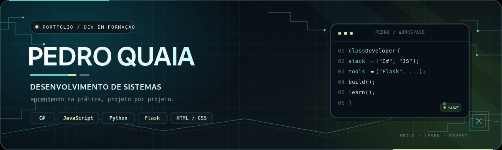

  

  
  
  

  

  <a href="#sobre-mim">Sobre mim</a>   ◈  
  <a href="#projetos">Projetos</a>   ◈  
  <a href="#tecnologias">Tecnologias</a>   ◈  
  <a href="#estatisticas">Estatísticas</a>

  

01 — Sobre mim
- 🧠 Estudando: Programação de sites e banco de dados
- 🛠️ Aprendendo a usar: C#, Python, JavaScript, HTML, CSS e MySQL.
 

02 — Projetos em destaque

  <table>
    <tr>
      <td width="50%" valign="top">
        <h3>🚛 <a href="https://github.com/PaquitoQuaia/projeto2.0">Truck Parts · projeto2.0</a></h3>
        Projeto de desenvolvimento em evolução. Um dos espaços onde pratico a construção de uma aplicação mais completa.
          
        
      </td>
      <td width="50%" valign="top">
        <h3>🌐 <a href="https://github.com/PaquitoQuaia/landpage">Landing page</a></h3>
        Experimento de criação de páginas web e organização de elementos de interface.
          
        
      </td>
    </tr>
    <tr>
      <td width="50%" valign="top">
        <h3>🎮 <a href="https://github.com/PaquitoQuaia/Jogos">Jogos</a></h3>
        Repositório para práticas e experiências relacionadas ao desenvolvimento de jogos.
          
        
      </td>
      <td width="50%" valign="top">
        <h3>📚 <a href="https://github.com/PaquitoQuaia/Exercicios">Exercícios</a></h3>
        Exercícios e pequenos programas para praticar lógica e consolidar os fundamentos.
          
        
      </td>
    </tr>
  </table>

  Conheça também os outros repositórios no <a href="https://github.com/PaquitoQuaia?tab=repositories">meu perfil</a>.

03 — Tecnologias & ferramentas

  <h3>Em aprendizado 📖</h3>
  
  
  
  
  
  

  

  <h3>Ferramentas 🧰</h3>
  
  
  

04 — Estatísticas do GitHub

  
  

  

Os cartões de estatísticas são gerados por serviços externos e podem levar algum tempo para carregar.

  <h3>Um commit de cada vez. 🚀</h3>
  
<i>Este perfil está em construção.</i>

  
    
  

