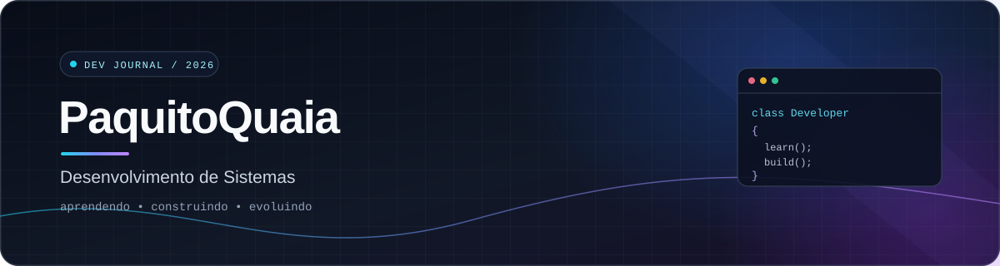

  

  <strong>Estudante de Desenvolvimento de Sistemas · SENAI</strong> 
  Aprendendo na prática, um projeto de cada vez.

  
  
  
  
  
  

---
👋 Sobre mim
Sou estudante de Técnico em Desenvolvimento de Sistemas no SENAI e uso este GitHub para praticar programação, organizar meus projetos e acompanhar minha evolução.
🧩 Estudando lógica de programação e orientação a objetos.
💻 Explorando C#, Python, JavaScript, desenvolvimento web e bancos de dados.
🛠️ Gosto de transformar ideias em projetos que funcionem de verdade.
📚 Sempre aprendendo e melhorando um pouco a cada versão.
🚀 Projetos
Projeto	Sobre
projeto2.0	Projeto de desenvolvimento em evolução.
landpage	Experimento de criação de página web.
Jogos	Espaço para projetos e práticas relacionadas a jogos.
Exercicios	Exercícios para praticar programação.
🧰 Tecnologias e ferramentas

  
  
  
  
  
  
  
  

---

  <em>Este perfil está em construção — assim como minhas habilidades. 🚧</em>

